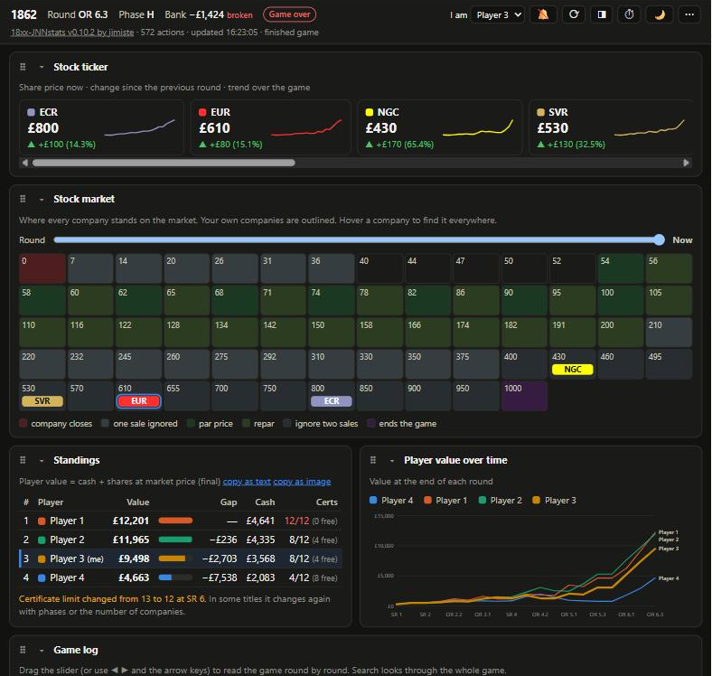
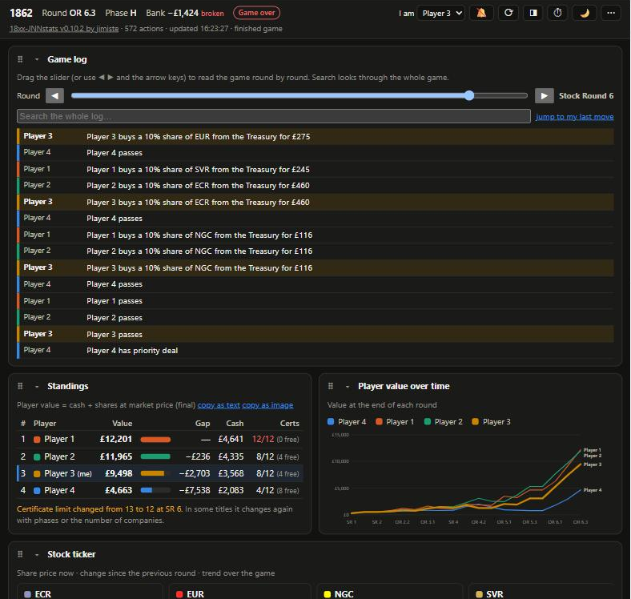

# 18xx-JNNstats

*By jimiste.*

A live stats window for [18xx.games](https://18xx.games). Click a bookmark while a game is open, and a second window shows charts, standings, portfolios and which trains are left. It updates every 10 seconds while you play and works just as well for reviewing finished games.

It replays the game with **18xx.games' own rules engine**, so the numbers follow each title's real rules and match the site exactly. In testing, every finished game's replayed final scores matched the official result to the dollar.






*Screenshots from a finished game, with the players shown as Player 1–4.*

## Install (once, about a minute)

You add a bookmark by hand. No browser extension, nothing to download.

1. Show the bookmarks bar if it is hidden: **Ctrl+Shift+B** (Windows) or **⌘+Shift+B** (Mac).
2. Right-click the bookmarks bar and choose **Add page…** (Chrome, Edge) or **Add Bookmark…** (Firefox).
3. Name: `18xx-JNNstats`
4. URL: copy and paste this whole line:

```
javascript:(function(){if(!/18xx\.games\/game\/\d+/.test(location.href)){alert('18xx-JNNstats: open a game on 18xx.games first.');return;}window.__xxStatsTarget=window.open('','xx-stats','width=1280,height=900');var s=document.createElement('script');s.src='https://cdn.jsdelivr.net/gh/mvhjim/18xx-jnnstats@main/stats.js?t='+Date.now();s.onerror=function(){alert('18xx-JNNstats: could not load the script from GitHub.');};document.head.appendChild(s);})();
```

5. Save.

The bookmark is only a loader: it fetches `stats.js` from this repository each time. When the code is improved here, the new version reaches everyone without reinstalling, usually within about 12 hours (the delivery network caches which version is newest). The version number is shown at the top of the stats window. To get a new version at once, see *Releasing* in [CONTRIBUTING.md](CONTRIBUTING.md).

## Use

1. Open any game on 18xx.games (its address looks like `https://18xx.games/game/` followed by a number).
2. Click **18xx-JNNstats** in the bookmarks bar. A stats window opens.
3. The first time, your browser may block the pop-up. Allow pop-ups for 18xx.games and click again.
4. Leave the window open. It updates the moment a move is made. If you reload or leave the game page, the stats window shows *Updates paused*; click the bookmark again on the game page.
5. To look at another game, old or live, open the **⋯** menu at the top of the stats window, type its number or link and press **Open**. Any title works.
6. **Half screen:** the window opens on the right half of your screen, so the game keeps the left half. Move or resize it and it remembers that next time; press **◨** to snap it back to the right half.
7. **Light or dark:** press ☀ / 🌙 at the top. By default it follows your system.
8. **Arrange it your way:** collapse a section with ▾, and move it by dragging the ⠿ handle or with ▲ ▼. The arrangement is saved separately for live games and for reviews of finished games. Live games start with *Trains & phases* near the top. **Reset layout** (in the **⋯** menu) restores the defaults.

## What the window shows

While a game is in progress:

- **Now:** who is to act, the order of the round, operating rounds left in the set, priority deal, a personal tile once you pick your name under *I am…*, a train rush warning and a game-end estimate.
- **What just happened:** the latest moves, with new ones marked. A second tab, *Since your last turn*, lists everything logged after your own last move (shown when there is something, and once you are picked under *I am…*; the page's logged-in name is picked automatically when it matches a player).
- **Stock round helper:** shares available, dividend per share, yield, presidency warnings, and where the price goes if a company pays or withholds.
- **Your turn:** a green frame around the window, ● in the title, and an optional sound.
- **Live movement:** when shares or trains change hands, a small chip glides from the old holder to the new one, and a rusted train fades out.

Always:

- **Stock market:** the title's own market grid with every company on its square, the price zones, your own companies outlined, and in a live game a dashed marker for where the acting company goes if it pays out or withholds. A slider steps the grid back through earlier rounds.
- **Stock ticker:** each company's share price, the change since the previous round, and a trend line.
- **Standings:** player value (cash + shares at market + private companies), gap to the leader, cash, certificates against the limit. **copy as text** puts the ranking and share prices on your clipboard; **copy as image** copies the ranking together with the Player value chart as a picture, for Discord or the forum.
- **Player value over time:** the score race, round by round.
- **Company revenue per OR:** ● paid out, ◉ half payout, ○ withheld; minors as dashed lines.
- **Share price** history.
- **Portfolios:** pick a player and see what they held over the game, stacked by company, with private companies and cash. Short positions (1817 family) go below zero.
- **Holdings now:** who owns what percentage of each company; ★ is president, shorts in red.
- **Trains & phases:** starts with the bank (cash, the trains still to come in order, trains in the bank pool, shares left in the initial offering and the market), then trains left per type, the next train, purchases until each phase change, what rusts next and which companies it hits.
- **Tile manifest** (collapsed by default): how many of each tile are left, by colour; colours the current phase does not allow yet are dimmed.
- **Game log:** the whole log of the game, one round at a time. Drag the slider (or press ◀ ▶) to walk through the game, search the whole log for a company or player, or jump to your own last move once you pick your name under *I am…*. Every line has the acting player's colour and name on the left, and your own lines are highlighted. Works in finished and live games.
- **History (⏱):** press ⏱ at the top and a slider appears. Drag it, or press ◀ ▶, and the whole window shows the game as it was at the end of that round: standings, corporations, trains, bank, market and log. It is paused and read only; **back to now** returns to the current state. Each step replays the game, so it takes a second or two the first time (visited rounds are remembered).
- **Hover linking:** hover a company anywhere and it lights up in every table and chart on screen.
- **Corporations:** whether the treasury covers the cheapest train or an emergency buy is needed, train health (*safe*, *will rust*, *obsolete*, *trainless in N buys*), tokens, loans and interest.
- **Minors & private companies** (collapsed by default): owners over time and when each closed.

## Tested titles

Tested on **82 games across 20 titles**. For all **67 finished games** with a recorded result, the replayed final scores match the site's official result exactly, including The Old Prince 1871, 1877: Stockholm Tramways and 1849: Kingdom of the Two Sicilies (12 games each).

The stock market grid was additionally checked on live and finished games of these titles: every company with a share price stands on the square with that price.

| Title | Market grid |
|---|---|
| 1830, 1856, 1870, 1889 | grid (11 rows) |
| 1849: Kingdom of the Two Sicilies | grid (10 rows) |
| 1861 | grid (10 rows) |
| 18Ireland, 18MEX | grid (8 rows) |
| The Old Prince 1871 | grid (7 rows) |
| 1866 | grid (4 rows) |
| 1817 | single row |
| 1846 | single row |
| 1862, 1864: Forty-Niner, 1822PNW, 18USA, 1877: Stockholm Tramways | single row |

Titles with no moves played yet when this was written (1822, 1824, 1844, 1850, 1860, 1880, 18NY, 18VA, 18Chesapeake, 18SJ, Harzbahn 1873, Rolling Stock Stars) load their rules from the site in the same way but are untested here. Reports are welcome.

Limits: 1822 and some newer titles were only tested on early-game positions. **Archived games** keep only their final result on 18xx.games, so the window shows that result and no history.

## Security

You are asked to run code from the internet on a page where you are logged in, so here is exactly what it does and how to keep control of it.

- **It reads, it never acts.** It replays the game with the site's own engine and draws numbers. It cannot make a move, change a setting or sign you in.
- **It only talks to 18xx.games.** The only network requests in the code are to the site's own game data (`/api/game/<number>`, the same data the page shows) and the site's own rules files. Nothing is sent to anyone else, there is no analytics, and no cookies or passwords are read.
- **Your settings stay in your browser.** Only a few small preferences are stored locally (your name selection, the sound switch, light/dark choice, window position and the section layout).
- **The "I am" auto-pick** only reads the display name in the page's header and compares it with the players of the game. It never touches passwords, cookies or tokens.
- **Update note:** once every six hours the window loads a one-line script, `version.js`, from this repository (through jsDelivr) to see if a newer version exists, and shows a link if so. It sends nothing about you or your game.
- **Names from games are escaped** before being shown, so a hostile player name cannot inject code into the stats window.
- **The one trust point is the loader.** The bookmark downloads `stats.js` from this GitHub repository through the jsDelivr CDN. Code running on a page can in principle see everything on that page, so you are trusting this repository and that CDN, as with any bookmarklet. An extension bundled in your browser does not update itself from the web; this does, unless you pin it.
- **How to stay in control:** read [stats.js](stats.js) (it is one readable file, GPL-licensed), read the [changelog](CHANGELOG.md) before updating, and **pin the bookmark to a commit** you have reviewed by replacing `@main` in the bookmark's address with `@` and the short commit hash from GitHub. A pinned address never changes, so nothing can be swapped in later. Switch back to `@main` when you want updates.

## Support

If 18xx-JNNstats is useful to you, you can buy me a coffee on [Ko-fi](https://ko-fi.com/jimiste). It is entirely optional; the tool stays free.

## Contributing

Ideas and fixes are welcome; see [CONTRIBUTING.md](CONTRIBUTING.md). Changes are listed in [CHANGELOG.md](CHANGELOG.md).

## Licence

Copyright (C) 2026 jimiste.

18xx-JNNstats is free software under the **GNU General Public License v3.0 or later** (see [LICENSE](LICENSE)). You may use, study, share and change it. If you distribute a changed version, it must also be released under the GPL with its source code, and must keep this copyright notice.

Not affiliated with 18xx.games; thanks to its authors for an open, well-structured engine.
